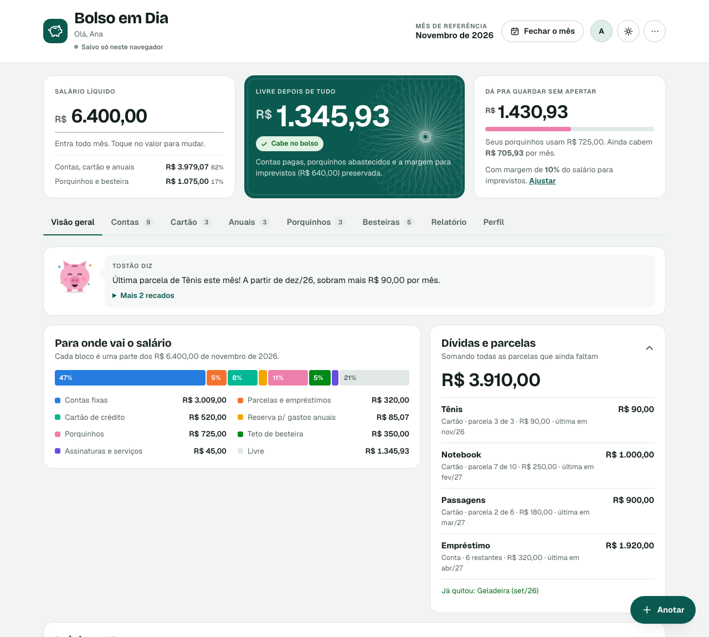
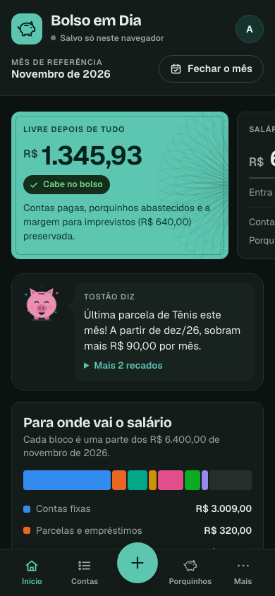

# Bolso em Dia

Controle de finanças pessoais que cabe num arquivo HTML: salário, contas fixas, parcelas, cartão de crédito, gastos anuais (IPVA, licenciamento), porquinhos e as pequenas besteiras do dia a dia.

Para usar, abra **<https://carolmoraiss.github.io/bolso-em-dia/>** no computador ou no celular. Não precisa de conta nem de instalação, e os dados ficam só no seu navegador. Para ter os mesmos dados no computador e no celular, dá para publicar a página no Google Apps Script da sua conta, com tudo guardado numa planilha do Google Sheets.

<p align="center">
  
  
</p>

<p align="center"><sub>As capturas usam dados fictícios.</sub></p>

## O que dá para fazer

- **Ver o mês de uma vez**: quanto entra, quanto já está comprometido, quanto fica livre e quanto dá para guardar sem apertar, sempre com uma margem para imprevistos.
- **Contas e parcelas**: contas fixas, assinaturas e empréstimos, com quantas parcelas faltam e o mês em que cada uma termina.
- **Cartão de crédito**: compras parceladas, limite usado e a fatura dos próximos meses.
- **Gastos do ano**: IPVA, licenciamento e seguros, à vista ou parcelados. Para os de pagamento à vista, a página separa um pouco por mês até o vencimento.
- **Porquinhos**: metas com ou sem prazo. A página calcula quanto guardar por mês e avisa quando o ritmo atual não chega a tempo.
- **Besteiras**: um teto mensal para os gastos pequenos, com anotação rápida pelo botão **Anotar**.
- **FGTS**: para quem tem carteira assinada. Calcula o depósito do mês, o 13º, o adicional de férias e o rendimento de 3% ao ano mais a TR, atualiza o saldo a cada mês fechado e mostra uma estimativa para os próximos 3 anos.
- **Fechar o mês**: avança para o mês seguinte, desconta as parcelas, registra o que foi quitado e enche os porquinhos. Os próximos 12 meses aparecem projetados.
- **Relatório**: uma folha pronta para imprimir ou salvar em PDF, só com as seções que você escolher.
- **Feito para o celular**: navegação inferior, blocos que abrem quando você precisa, tema claro e escuro e animações que respeitam a opção "Reduzir movimento" do sistema.

### Tostão, o mascote

O Tostão funciona com regras simples escritas no próprio código: não usa inteligência artificial e não manda nada para fora. A cada mudança, ele olha os números do mês e mostra o recado mais importante. Os outros ficam em **Mais recados**.

| Quando | O que ele diz |
|---|---|
| O dinheiro não fecha o mês | "Você, Ana, está se passando esse mês: faltam R$ 120,00 para fechar a conta. Poupe money, bicha!" |
| As besteiras passaram do teto | quanto passou, com um atalho para a aba Besteiras |
| Um porquinho não vai chegar a tempo | quanto você guarda hoje e quanto precisaria guardar por mês |
| Um gasto anual está sem valor ou sem mês | "Você esqueceu de informar o mês de vencimento de Licenciamento." |
| O FGTS está ligado, mas sem o salário bruto | pede o bruto para o depósito ficar exato |
| É a última parcela de algo | comemora e diz quanto sobra a partir do mês seguinte |
| A fatura do cartão vai diminuir | o valor da próxima fatura e quanto ela diminui |
| Uma semana sem anotar besteira | pergunta se você não esqueceu de alguma |
| Muito tempo sem backup (no modo arquivo) | sugere exportar uma cópia |
| O mês foi fechado no azul | "Você, Ana, economizou bastante em outubro, parabéns!" |

### Como o FGTS é calculado

Quando o FGTS está ligado na aba de mesmo nome, cada mês fechado faz três coisas:

- **Depósito:** soma 8% do salário bruto (2% para jovem aprendiz; o percentual pode ser trocado). Com 13º salário, entram mais 8% dele, metade em novembro e metade em dezembro. No mês das férias, entram mais 8% sobre o terço de férias.
- **Rendimento:** o saldo rende 3% ao ano, capitalizados por mês (0,2466% ao mês), mais a TR do mês: `(1 + TR) × (1 + 0,2466%) − 1`. A TR muda todo mês, e o valor padrão é 0,15% ao mês, perto de onde ela ficou em 2026.
- **Saldo novo:** saldo + rendimento + depósito.

A aba mostra a conta do mês atual e uma estimativa para os próximos 3 anos, com gráfico e tabela ano a ano. Ela também entra no relatório. A estimativa usa o salário de hoje e não conta aumentos, saques nem a distribuição anual de lucros do fundo. Desde 2024, o [STF garante](https://noticias.stf.jus.br/postsnoticias/saldos-do-fgts-devem-ser-corrigidas-no-minimo-pelo-indice-da-inflacao-decide-stf/) que o FGTS renda pelo menos a inflação (IPCA). Como essas partes ficam de fora, o saldo real tende a ser um pouco maior. Para alinhar com o extrato do app FGTS, basta corrigir o saldo.

## Como usar

Há três jeitos, todos com as mesmas telas. A diferença é onde os dados ficam guardados.

| | Pelo link | Arquivo baixado | Google Apps Script |
|---|---|---|---|
| Onde ficam os dados | no navegador em que você abriu | no navegador em que você abriu | numa planilha do Google Sheets da sua conta, com uma cópia no aparelho |
| Computador e celular juntos | não; o backup leva os dados de um para o outro | não; o backup leva os dados de um para o outro | sim, pelo mesmo link |
| Sem internet | precisa de internet para abrir | funciona | precisa para abrir; o que mudar sem conexão é enviado depois |
| Precisa de conta | não | não | conta Google |
| Instalação | nenhuma | nenhuma | uma vez, uns 10 minutos |

Para escolher ou trocar, use o botão **Onde salvar**, que fica embaixo do nome **Bolso em Dia** no topo, em **⋯ › Onde salvar** e na aba **Perfil**. Ele mostra as duas opções, "Neste aparelho" ou "Na minha planilha do Google", e leva os dados de um lugar para o outro (veja [Trocar entre este aparelho e o Google](#trocar-entre-este-aparelho-e-o-google)).

No primeiro acesso, o Tostão pergunta só o seu nome e o salário. Depois disso, o guia **Primeiros passos** mostra o que falta preencher (contas, cartão, gastos do ano, um porquinho e o teto de besteiras) e some quando tudo está pronto. A aba **Perfil** mostra o nome, desde quando você usa, a conta Google vinculada e onde os dados estão guardados.

### Pelo link (o mais fácil)

1. Abra **<https://carolmoraiss.github.io/bolso-em-dia/>** no computador ou no celular.
2. No celular, use **Adicionar à tela inicial** (no Safari, pelo botão Compartilhar; no Chrome, pelo menu ⋮) para abrir como um aplicativo.

Os dados ficam só no navegador daquele aparelho e não são enviados para o GitHub nem para ninguém. Limpar os dados do navegador apaga tudo, então exporte um backup de vez em quando em **⋯ › Exportar backup**. Se passar de 30 dias sem backup, o Tostão lembra. Para levar os dados a outro aparelho, exporte num e use **⋯ › Importar backup** no outro.

### Arquivo baixado

1. Baixe o `bolso-em-dia.html` da [última versão publicada](https://github.com/carolmoraiss/bolso-em-dia/releases/latest) ou gere o arquivo a partir do código com `python3 montar.py` (ele fica em `dist/bolso-em-dia.html`).
2. Abra o arquivo no navegador do computador. Funciona até sem internet.

No celular, prefira o link: o iPhone abre arquivos HTML só numa pré-visualização, e o Chrome do Android bloqueia arquivos locais. Os dados do link e os do arquivo não se misturam, porque cada um tem o seu próprio armazenamento no navegador.

### No Google, sincronizado

A página roda como app da Web no Google Apps Script, com acesso **Somente eu**, e grava tudo numa planilha chamada **Bolso em Dia** criada na sua conta.

#### Instalação pelo terminal

Precisa de Node.js e Python 3.

1. Ligue a **API do Google Apps Script** em <https://script.google.com/home/usersettings>.
2. Entre com a sua conta Google (o navegador vai abrir):
   ```bash
   npx --yes @google/clasp@3.4.1 login
   ```
3. Rode o instalador. Ele cria a planilha, envia o código, publica o app e mostra o link:
   ```bash
   ./instalar.sh
   ```
4. Abra o link. Na primeira vez, o Google pede autorização: **Revisar permissões › sua conta › Avançado › Acessar Bolso em Dia › Permitir**.

Para publicar uma versão nova mantendo o mesmo link, rode `./atualizar.sh`.

#### Instalação pelo navegador

1. Abra <https://sheets.new> e dê o nome **Bolso em Dia** para a planilha.
2. No menu da planilha, abra **Extensões › Apps Script**.
3. No arquivo `Código.gs`, apague tudo e cole o conteúdo de [`Code.gs`](Code.gs).
4. Clique no **+** ao lado de "Arquivos", escolha **HTML**, dê o nome **`Index`** (sem `.html`) e cole o conteúdo de `Index.html`. O arquivo está na [última versão publicada](https://github.com/carolmoraiss/bolso-em-dia/releases/latest), ou em `dist/Index.html` depois de rodar `python3 montar.py`.
5. Em **Configurações do projeto** (ícone de engrenagem), marque **Mostrar o arquivo de manifesto "appsscript.json" no editor**. Volte ao editor e troque o conteúdo desse arquivo pelo de [`appsscript.json`](appsscript.json). Isso limita o script a duas permissões e acerta o fuso horário.
6. Salve e vá em **Implantar › Nova implantação**. Na engrenagem ao lado de "Selecionar tipo", escolha **App da Web** e configure:
   - Executar como: **Eu**
   - Quem pode acessar: **Somente eu**
7. Clique em **Implantar › Autorizar acesso** e escolha sua conta. O Google avisa que não verificou o app: clique em **Avançado › Acessar Bolso em Dia (não seguro)**. O aviso aparece porque o script é seu e roda só na sua conta.
8. Copie o **URL do app da Web** (termina em `/exec`) e abra no computador e no celular. No celular, a opção **Adicionar à tela inicial** deixa a página com cara de aplicativo.

Para atualizar depois: cole os arquivos novos nos mesmos lugares e vá em **Implantar › Gerenciar implantações › lápis › Versão: Nova versão › Implantar**. O link continua o mesmo.

### Trocar entre este aparelho e o Google

A página do link e o arquivo guardam os dados no navegador. A versão do Google guarda na planilha. Uma não grava direto na outra, porque isso exigiria um login Google próprio na página. O botão **Onde salvar** faz a ponte:

- **Do aparelho para o Google:** escolha **Na minha planilha do Google** e cole o link do seu Bolso em Dia no Google (o que termina em `/exec`). Com **Levar os dados deste aparelho** marcado, a página baixa um arquivo com os seus dados e abre o Google em outra aba. Lá, use **⋯ › Importar backup** e escolha esse arquivo. Depois disso, a página do link lembra da escolha e mostra um aviso com o botão **Abrir no Google**.
- **Do Google para o aparelho:** na versão do Google, escolha **Neste aparelho**. A página baixa um arquivo e abre a versão sem conta, onde você toca em **Tenho um backup**.
- **Quem já usa pelo Google** e abre o link pela primeira vez pode tocar em **Já uso o Bolso em Dia pelo Google**, na tela de boas-vindas.

Antes de substituir qualquer coisa, a importação mostra o que existe em cada lado (salário, quantidade de contas, compras no cartão, porquinhos e mês de referência) e pergunta qual manter. Logo depois, ainda dá para desfazer. O arquivo baixado não tem senha, então apague-o depois de importar.

## Como os dados são salvos no Google

- Cada alteração vai para a planilha alguns segundos depois. O status aparece embaixo do nome **Bolso em Dia**. Toque nele para salvar ou buscar na hora.
- Sem internet, a alteração fica guardada no aparelho e é enviada quando a conexão volta.
- Cada gravação ganha um número de versão. Se outro aparelho, ou uma edição direto na planilha, mudou algo antes, a página pergunta qual versão manter em vez de sobrescrever.
- Dá para editar direto na planilha, desde que a ordem das colunas e o nome das abas continuem iguais.

| Aba | O que tem |
|---|---|
| Contas | contas do mês, assinaturas e empréstimos |
| Cartão | valor da parcela, parcela atual e total |
| Anuais | IPVA, licenciamento e outros, à vista ou parcelados |
| Porquinhos | meta, quanto já foi guardado, prazo e quanto guardar por mês |
| Besteiras | todas as anotações, cada uma com o seu mês |
| Meses | uma linha por mês fechado: salário, contas, porquinhos, besteiras e quanto ficou livre |
| Quitadas | o que terminou de ser pago e em que mês |
| Config | nome, mês de referência, salário, margem, teto, dados do FGTS e controle de versão |

## Segurança

**O que o projeto já faz**

- **Acesso restrito**: o app é publicado com acesso **Somente eu**, e só a sua conta Google abre o link. O manifesto limita o script a duas permissões: suas planilhas e o seu e-mail, usado para mostrar a conta vinculada.
- **Validação na entrada**: tudo o que chega de fora (planilha, backup importado, armazenamento do navegador) passa por uma única função de validação antes de aparecer na tela. Ela aceita só campos conhecidos, números finitos, textos curtos sem caracteres de controle e datas e códigos em formato fixo. Textos livres são escapados antes de virar HTML. Isso impede que um backup adulterado, ou alguém com acesso à planilha, rode código na página.
- **Sem injeção de fórmula**: textos que começam com `=`, `+`, `-` ou `@` são gravados na planilha como texto, nunca como fórmula. Isso impede, por exemplo, uma fórmula que mande os dados da planilha para outro site.
- **Limites no servidor**: envios grandes demais ou fora do formato são recusados, e a gravação usa trava para dois aparelhos não escreverem ao mesmo tempo.
- **Backup com senha**: **⋯ › Exportar backup** oferece proteger o arquivo com senha, usando AES-256-GCM e chave derivada com PBKDF2-SHA256 em 310 mil iterações. Sem a senha o arquivo é ilegível, e se ele for alterado a importação é recusada.
- **Página isolada**: a versão do link e do arquivo traz uma Content Security Policy que impede a página de carregar ou enviar qualquer coisa para outros sites, com exceção das fontes do Google. Nenhum endereço é enviado junto (referrer desligado). Ela também se recusa a aparecer dentro de outro site, o que impede alguém de esconder a página atrás de botões falsos (clickjacking).
- **Publicação verificada**: o GitHub Pages só recebe uma versão nova depois que lint, testes e `npm audit` passam. As actions do GitHub ficam fixadas pelo SHA do commit, e não por uma tag que poderia ser trocada.
- **Nenhuma biblioteca de terceiros** dentro da página ou do servidor. As ferramentas de desenvolvimento ficam com versão exata no `package.json`, e o `npm audit` não aponta nenhuma falha.
- **Computador emprestado**: **⋯ › Apagar dados deste aparelho** remove a cópia do navegador. No modo Google, os dados continuam na planilha.

**O que depende de você**

- Mantenha **Quem pode acessar** em **Somente eu**.
- Não compartilhe a planilha: quem tiver acesso a ela vê tudo.
- Prefira o backup **com senha**, principalmente se for mandar o arquivo por mensagem ou e-mail.
- O `clasp` guarda uma chave de acesso em `~/.clasprc.json` (os scripts deixam esse arquivo legível só pelo seu usuário). Se não for atualizar a página por um tempo, rode `npx --yes @google/clasp@3.4.1 logout` ou revogue o acesso em <https://myaccount.google.com/permissions>.
- **Para quem mantém o projeto**: todas as páginas publicadas em `carolmoraiss.github.io` dividem o mesmo armazenamento do navegador. Qualquer outro projeto publicado no GitHub Pages dessa conta conseguiria ler os dados que o Bolso em Dia guarda nos navegadores dos visitantes. Não publique no Pages dessa conta código que não foi revisado. Para isolar de vez, use um domínio próprio.
- O `clasp` 3.4.1, a versão mais recente, tem 8 alertas do `npm audit` (6 moderados e 2 altos) em dependências internas como `zod`, `minimatch` e `glob`. São falhas de travamento por excesso de dados locais, e a única correção disponível quebra o próprio `clasp`. Ele só roda na sua máquina na hora de instalar ou atualizar. Se preferir não usar nenhuma dependência, faça a instalação pelo navegador.

## Desenvolvimento

Requisitos: Node.js 22.22.2 ou mais novo (ou 24.15+ ou 26+), npm e Python 3.

```bash
npm ci
npm run build    # gera dist/Index.html e dist/bolso-em-dia.html
npm run lint     # ESLint, Stylelint e html-validate
npm test         # testes de cálculo, validação, criptografia e servidor
npm run check    # lint, testes e npm audit
```

Os testes usam o executor nativo do Node (`node:test`) e rodam o `Code.gs` de verdade contra uma planilha simulada em memória, com dados fictícios.

A cada merge na `main`, o workflow `.github/workflows/pages.yml` roda `npm run check` e, se tudo passar, publica o `dist/bolso-em-dia.html` no GitHub Pages. Toda semana, o Dependabot abre PRs para a `develop` com atualizações dos pacotes npm e das actions.

### Estrutura

| Caminho | O que é |
|---|---|
| `fonte/cabecalho.html` | `<head>` da página, com os marcadores `{{CSP}}` e `{{ESTILO}}` |
| `fonte/estilo.css` | todo o CSS, com as cores em variáveis para os temas claro e escuro |
| `fonte/corpo.html` | marcação: abas, blocos, navegação e diálogos |
| `fonte/app.js` | cálculos, telas, Tostão, movimento, sincronização e backup |
| `Code.gs` | servidor no Apps Script: lê e grava a planilha |
| `appsscript.json` | manifesto: fuso horário, acesso **Somente eu** e as duas permissões |
| `montar.py` | junta `fonte/` em `dist/Index.html` (Apps Script) e `dist/bolso-em-dia.html` (arquivo local, com CSP) |
| `instalar.sh`, `atualizar.sh` | instalação e atualização pelo terminal, com `clasp` |
| `testes/` | testes automatizados |
| `.github/` | publicação no GitHub Pages e configuração do Dependabot |
| `docs/` | imagens deste README |

### Decisões técnicas

- **Um único HTML, sem framework**: HTML, CSS e JavaScript puros. O Apps Script serve um arquivo HTML só, e esse mesmo arquivo abre sem internet no navegador. O `montar.py` apenas junta as partes.
- **Recursos nativos do navegador**: gráficos em SVG, animações com Web Animations API e View Transitions, criptografia com Web Crypto. Não há dependência para manter atualizada dentro da página.
- **Uma porta de entrada para os dados**: a função `normalizar()` valida tudo o que chega do navegador, da planilha ou de um backup, e as migrações de formato acontecem logo depois dela.
- **Concorrência otimista**: o número de versão fica na aba Config. Uma gravação com versão desatualizada vira conflito em vez de sobrescrever, e o gatilho `onEdit` sobe a versão quando alguém edita a planilha à mão.
- **Duas saídas do mesmo código**: a versão do Apps Script não leva CSP própria, porque o Google serve a página num iframe isolado em `googleusercontent.com` e injeta os próprios scripts. A versão local, que também é a do GitHub Pages, leva uma CSP que bloqueia qualquer conexão e se esconde quando aberta dentro de um iframe de outro site. Essa proteção fica desligada quando a página é aberta como arquivo, porque nenhum site consegue embutir um arquivo local.
- **Media queries com `min-width`/`max-width`**: a sintaxe de intervalo (`width <= 600px`) não funciona no Safari anterior ao 16.4, ainda comum em Macs e iPhones mais antigos. A regra do Stylelint está configurada para exigir a forma compatível.

## Problemas comuns

- **"Não foi possível abrir o arquivo" no celular**: acontece quando o navegador tem mais de uma conta Google conectada. Abra numa aba anônima entrando só com a sua conta, ou saia das outras contas nesse navegador.
- **O botão de imprimir não abre dentro do Google**: na aba **Relatório**, use **Abrir em nova aba** e imprima ou salve em PDF por lá.
- **A página abriu nas boas-vindas, mas eu já tinha dados**: use **Tenho um backup** e escolha o arquivo exportado.
